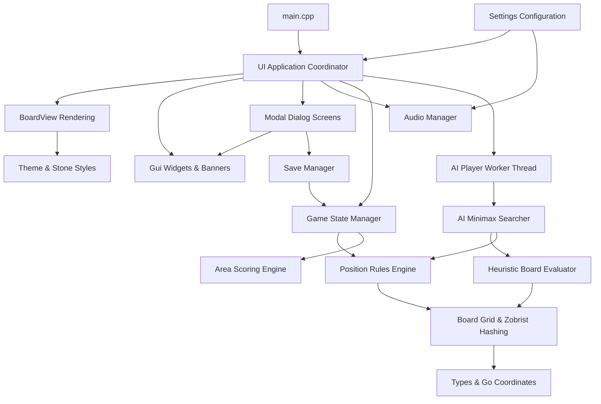

# Go Game - Project Report & C++ Development Guide

---

## 1. Title Page & Submission Information

- **Course:** Introduction to Programming (CS160)
- **Project Title:** Desktop Go Game with AI Opponent
- **Department:** Department of Software Engineering, Faculty of Information Technology
- **Institution:** VNU-HCM University of Science (HCMUS)
- **Submission Date:** October 2026 `[Or actual submission date - Placeholder]`
- **Project Team:**
  - `[Member 1 Name - e.g., Le Van Trong Hiep]` - `[Student ID 1]`
  - `[Member 2 Name - Placeholder]` - `[Student ID 2]`
  - `[Member 3 Name - Placeholder]` - `[Student ID 3]`
  - `[Member 4 Name - Placeholder]` - `[Student ID 4]`

---

## 2. Project Overview & Objectives

### 2.1 Overview
The game of Go (*Weiqi* / *Baduk*) is one of the oldest and most strategically profound abstract board games in human history, originating in ancient China over 2,500 years ago. Despite its simple fundamental rules—two players take turns placing black and white stones on a grid to enclose territory and capture opponent stones—its branching factor exceeds that of chess by orders of magnitude.

This project delivers a complete, production-grade desktop Go application developed in modern C++ (C++20 standard) with hardware-accelerated 2D rendering and spatial audio provided by the Simple and Fast Multimedia Library (SFML 3). The software supports two primary gameplay modes: local Player vs Player and Player vs AI with three distinct, meticulously tuned difficulty tiers (Easy, Medium, and Hard).

### 2.2 Objectives
1. **Rule Engine Integrity:** Implement and strictly enforce the fundamental rules of Go, including stone placement, liberty evaluation, multi-group orthogonal capture, suicide prohibition, and positional superko prevention via 64-bit Zobrist hashing.
2. **AI Development:** Implement an autonomous opponent system featuring random exploration (Easy), Minimax evaluation (Medium), and iterative-deepening Minimax with Alpha-Beta pruning on an asynchronous worker thread (Hard).
3. **State Management & Undo/Redo:** Provide transactional state handling with snapshot stacks supporting full undo and redo operations, including multi-move exchange steps in AI mode.
4. **Scoring & Territory Analysis:** Implement area scoring based on living stones, enclosed territory flood-fill algorithms, and interactive dead-group marking during the end-game review phase.
5. **Aesthetic User Experience:** Deliver an interface featuring multiple board wood themes, stone rendering styles, audio soundscapes, and customizable controls.
6. **Persistence:** Offer a versioned, validated plain-text save format resistant to corruption, alongside persistent user preference configuration.

---

## 3. Requirements Specification & Compliance Matrix

| Requirement Category | Specification Detail | Status | Implementation Reference |
| :--- | :--- | :--- | :--- |
| **Game Modes** | Player vs Player (Local on device; P1=White, P2=Black, Black moves first) | **Complete** | `Game.cpp`, `UI.cpp` |
| | Player vs AI (Selectable Easy, Medium, Hard difficulty) | **Complete** | `AI.cpp`, `Game.cpp` |
| | Human color selection in AI mode (default Black, option White) | **Complete** | `GameConfig`, `Screens.cpp` |
| **Board & Interactions** | 19x19 standard board with 13x13 and 9x9 options | **Complete** | `Board.h`, `BoardView.cpp` |
| | Accurate intersection snap clicking with hover preview | **Complete** | `BoardView.cpp`, `UI.cpp` |
| | Star points (*hoshi*) displayed accurately for all board dimensions | **Complete** | `BoardView.cpp` |
| | Visual indicators for active turn, captured stones, and last move | **Complete** | `UI.cpp`, `BoardView.cpp` |
| | Edge coordinate labels (A–T skipping I, 1–19) with toggle | **Complete** | `BoardView.cpp`, `Types.cpp` |
| | Move history list with Go notation | **Complete** | `UI.cpp`, `Types.cpp` |
| **Rules Engine** | Orthogonal liberty calculation and multi-group capture | **Complete** | `Board.cpp`, `Position.cpp` |
| | Suicide move rejection with visual/auditory feedback | **Complete** | `Board.cpp`, `Position.cpp` |
| | Positional superko prevention via 64-bit Zobrist hash history | **Complete** | `Board.cpp`, `Position.cpp` |
| | Pass move handling; 2 consecutive passes trigger scoring review | **Complete** | `Game.cpp`, `Position.cpp` |
| **End-Game Scoring** | Area scoring algorithm (stones + enclosed eyes + komi) | **Complete** | `Scoring.cpp` |
| | Interactive dead stone group marking during scoring review | **Complete** | `Game.cpp`, `BoardView.cpp` |
| | Option to resume play or accept result and view winner margin | **Complete** | `Screens.cpp`, `UI.cpp` |
| **AI Algorithms** | Easy: Fast randomized selection from legal non-suicide moves | **Complete** | `AI.cpp` |
| | Medium: Shallow Minimax search with heuristic evaluation | **Complete** | `AI.cpp`, `Evaluator.cpp` |
| | Hard: Iterative-deepening Alpha-Beta search with candidate filtering | **Complete** | `AI.cpp`, `Evaluator.cpp` |
| | Asynchronous non-blocking background thread execution | **Complete** | `AIPlayer` in `AI.cpp` |
| **State Management** | Deep snapshot stacks for Undo and Redo operations | **Complete** | `Game.cpp` |
| | Atomic 2-move human+AI exchange undo in Player vs AI mode | **Complete** | `Game::undoTurn()` |
| | Clean board reset returning to opening position | **Complete** | `Game::reset()` |
| **Persistence** | Versioned, human-readable plain-text save format (`.gosave`) | **Complete** | `SaveManager.cpp` |
| | Transactional loading with move replay and state verification | **Complete** | `SaveManager.cpp` |
| | User settings file (`settings.cfg`) persisting themes & volumes | **Complete** | `Settings.cpp` |
| **Customization & Audio**| 5 board themes (Kaya Wood, Bamboo, Walnut, Slate Blue, Jade) | **Complete** | `Theme.cpp` |
| | 3 stone styles (Classic, Modern, Cartoon) | **Complete** | `Theme.cpp` |
| | 3 sound themes (Wooden, Glass, Retro) with volume sliders | **Complete** | `Audio.cpp` |
| | 3 ambient music tracks (Zen Garden, Night Rain, Mountain Stream) | **Complete** | `Audio.cpp` |

---

## 4. High-Level Architecture & Design Decisions

### 4.1 Architectural Decoupling
The codebase is strictly structured into three decoupled layers:
1. **Core Domain & Rules Layer (`gocore` library):** Independent of all graphical and platform-specific window APIs. Contains `Types`, `Board`, `Position`, `Scoring`, `Game`, `Evaluator`, `AI`, `SaveManager`, and `Settings`. It can be compiled and executed on headless servers, embedded targets, or automated testing harnesses without an X11, Wayland, or Win32 display server.
2. **Presentation & View Layer (`GoGame` executable):** Uses SFML 3 for rendering (`BoardView`, `Theme`), widget interaction (`Gui`), modal dialog screens (`Screens`), and background audio streaming (`Audio`).
3. **Application Coordinator (`UI` class):** Orchestrates user input events, manages the display render loop, coordinates asynchronous AI background futures, and updates notification banners.

### 4.2 Module Dependency Diagram



---

## 5. C++ Game Development Tutorial (Comprehensive Guide)

This section provides a tutorial for developers creating modern desktop games and graphical applications in C++ using CMake and the Simple and Fast Multimedia Library (SFML 3).

---

### 5.1 Environment & Toolchain Setup

Developing high-performance desktop games requires a standards-compliant C++ compiler (supporting at least C++20 for modern features such as designated initializers, `std::optional`, `<filesystem>`, concepts, and standard threading utilities) and an efficient build system.

#### 5.1.1 Windows Environment Setup
On Microsoft Windows, the recommended native development toolchain is MinGW-w64 through MSYS2 (specifically the modern UCRT64 environment, which links against the universal C runtime `ucrtbase.dll` rather than legacy `msvcrt.dll`):
1. Install MSYS2 from `https://www.msys2.org/`.
2. Open the **MSYS2 UCRT64** terminal and install the toolchain, CMake, Ninja, and SFML 3:
   ```bash
   pacman -Syu
   pacman -S --needed mingw-w64-ucrt-x86_64-gcc \
                      mingw-w64-ucrt-x86_64-g++ \
                      mingw-w64-ucrt-x86_64-cmake \
                      mingw-w64-ucrt-x86_64-ninja \
                      mingw-w64-ucrt-x86_64-sfml
   ```
3. Add `C:\msys64\ucrt64\bin` to your Windows user `PATH` environment variable.

#### 5.1.2 Linux Environment Setup (Ubuntu / Debian / Arch)
On Linux distributions, GCC or Clang combined with system multimedia libraries provides the foundation:
- **Ubuntu / Debian:**
  ```bash
  sudo apt-get update
  sudo apt-get install -y build-essential cmake ninja-build \
                          libx11-dev libxrandr-dev libxcursor-dev \
                          libxi-dev libgl1-mesa-dev libudev-dev \
                          libfreetype-dev libopenal-dev libflac-dev libvorbis-dev
  ```
- **Arch Linux:**
  ```bash
  sudo pacman -S base-devel cmake ninja sfml
  ```

#### 5.1.3 macOS Environment Setup
On macOS, using Homebrew:
```bash
brew install cmake ninja sfml
```

---

### 5.2 Selected Libraries & Technology Stack

When building a 2D desktop game or board game application, developers frequently evaluate four major frameworks:
1. **SFML (Simple and Fast Multimedia Library):** Written in clean, idiomatic object-oriented C++. It provides distinct modules (`Graphics`, `Window`, `Audio`, `Network`, `System`) without imposing an opinionated paradigm. It is well-suited for games requiring custom rendering pipelines, high-precision geometry, and direct audio control.
2. **SDL2 / SDL3 (Simple DirectMedia Layer):** Written in C. It provides low-level hardware access, but lacks native C++ abstractions for vector shapes, transformations, and object management without third-party wrappers.
3. **Raylib:** A lightweight C library centered around immediate-mode graphics.
4. **Qt:** A heavyweight application framework. While feature-rich, Qt introduces significant binary size, complex meta-object compilation steps (`moc`), and overhead unnecessary for custom-rendered games.

For this project, **SFML 3.0** was selected. SFML 3 modernizes the library's API:
- Type-safe event dispatching using `std::optional<sf::Event>` and `event->getIf<T>()` instead of union-based polling.
- Standard C++ filesystem types (`std::filesystem::path`) for all resource loading.
- Strongly-typed vector and rectangle structures (`sf::Vector2u`, `sf::Vector2f`, `sf::FloatRect` with explicit `.position` and `.size`).

---

### 5.3 Project Setup with CMake

A scalable project structure separates build automation, public header interfaces, private implementation sources, test cases, and static assets.

```text
MyGame/
├── CMakeLists.txt
├── include/
│   ├── GameCore.h
│   └── AppView.h
├── src/
│   ├── main.cpp
│   ├── GameCore.cpp
│   └── AppView.cpp
├── assets/
│   ├── fonts/
│   └── audio/
└── tests/
    └── core_tests.cpp
```

Here is a standard, cross-platform `CMakeLists.txt` for an SFML 3 project:

```cmake
cmake_minimum_required(VERSION 3.20)
project(MyGame VERSION 1.0.0 LANGUAGES CXX)

set(CMAKE_CXX_STANDARD 20)
set(CMAKE_CXX_STANDARD_REQUIRED ON)
set(CMAKE_CXX_EXTENSIONS OFF)

find_package(Threads REQUIRED)
find_package(SFML 3 REQUIRED COMPONENTS Graphics Audio)

add_executable(MyGame
    src/main.cpp
    src/GameCore.cpp
    src/AppView.cpp
)

target_include_directories(MyGame PRIVATE include)
target_link_libraries(MyGame PRIVATE SFML::Graphics SFML::Audio Threads::Threads)

if(MSVC)
    target_compile_options(MyGame PRIVATE /W4 /permissive-)
else()
    target_compile_options(MyGame PRIVATE -Wall -Wextra -Wpedantic)
endif()
```

---

### 5.4 A Complete Starter Example

The following standalone starter example demonstrates an interactive board game prototype featuring an animated grid, stone placement on intersection click, audio feedback, and clean event processing under SFML 3:

```cpp
#include <SFML/Graphics.hpp>
#include <SFML/Audio.hpp>
#include <iostream>
#include <vector>
#include <cmath>

enum class Piece { None, Black, White };

struct GridBoard {
    static constexpr int size = 9;
    std::vector<Piece> cells;
    Piece currentTurn = Piece::Black;

    GridBoard() : cells(size * size, Piece::None) {}

    bool play(int row, int col) {
        if (row < 0 || row >= size || col < 0 || col >= size) return false;
        if (cells[row * size + col] != Piece::None) return false;
        cells[row * size + col] = currentTurn;
        currentTurn = (currentTurn == Piece::Black) ? Piece::White : Piece::Black;
        return true;
    }
};

int main() {
    sf::RenderWindow window(sf::VideoMode({800, 800}), "C++ Game Tutorial - Mini Board");
    window.setFramerateLimit(60);

    GridBoard board;
    const float boardMargin = 80.0f;
    const float gridSpan = 640.0f;
    const float cellPitch = gridSpan / (GridBoard::size - 1);
    const float stoneRadius = cellPitch * 0.45f;

    while (window.isOpen()) {
        while (const auto event = window.pollEvent()) {
            if (event->is<sf::Event::Closed>()) {
                window.close();
            } else if (const auto* click = event->getIf<sf::Event::MouseButtonPressed>()) {
                if (click->button == sf::Mouse::Button::Left) {
                    float relX = click->position.x - boardMargin;
                    float relY = click->position.y - boardMargin;
                    int col = static_cast<int>(std::round(relX / cellPitch));
                    int row = static_cast<int>(std::round(relY / cellPitch));
                    board.play(row, col);
                }
            }
        }

        window.clear(sf::Color(220, 180, 100));

        for (int i = 0; i < GridBoard::size; ++i) {
            float pos = boardMargin + i * cellPitch;
            sf::RectangleShape hLine({gridSpan, 2.0f});
            hLine.setPosition({boardMargin, pos - 1.0f});
            hLine.setFillColor(sf::Color(60, 40, 20));
            window.draw(hLine);

            sf::RectangleShape vLine({2.0f, gridSpan});
            vLine.setPosition({pos - 1.0f, boardMargin});
            vLine.setFillColor(sf::Color(60, 40, 20));
            window.draw(vLine);
        }

        for (int r = 0; r < GridBoard::size; ++r) {
            for (int c = 0; c < GridBoard::size; ++c) {
                Piece piece = board.cells[r * GridBoard::size + c];
                if (piece == Piece::None) continue;
                sf::CircleShape stone(stoneRadius);
                stone.setOrigin({stoneRadius, stoneRadius});
                stone.setPosition({boardMargin + c * cellPitch, boardMargin + r * cellPitch});
                stone.setFillColor(piece == Piece::Black ? sf::Color(20, 20, 20) : sf::Color(245, 245, 245));
                stone.setOutlineThickness(1.5f);
                stone.setOutlineColor(sf::Color(100, 100, 100));
                window.draw(stone);
            }
        }

        window.display();
    }
    return 0;
}
```

---

### 5.5 Detailed Step-by-Step Code Explanation

1. **The Game State Container (`GridBoard`):**
   Encapsulates state independently of rendering. The board is represented as a contiguous 1D array (`cells`) of size $N \times N$, offering cache locality compared to pointer-heavy dynamic structures.
2. **SFML 3 Window & Display Configuration:**
   `sf::RenderWindow` initializes an OS-level desktop window. `setFramerateLimit(60)` synchronizes the game loop with display refreshes to avoid wasteful 100% CPU thread polling.
3. **Type-Safe Event Polling:**
   SFML 3 uses `window.pollEvent()` returning an optional event, and inspects event types using `event->getIf<sf::Event::MouseButtonPressed>()`. This eliminates casting errors.
4. **Coordinate Mapping (Screen Space to Grid Space):**
   Mouse coordinates `(x, y)` are translated into discrete intersection indices `(row, col)` via floating-point division and rounding:
   $$\text{col} = \text{round}\left(\frac{x - \text{margin}}{\text{cellPitch}}\right), \quad \text{row} = \text{round}\left(\frac{y - \text{margin}}{\text{cellPitch}}\right)$$
   Hit-testing validates that the distance between the mouse position and the intersection falls within the snap threshold before placing a stone.
5. **Double-Buffered Rendering:**
   `window.clear()` wipes the back-buffer with the background color, shape rendering draws the grid lines and placed pieces, and `window.display()` performs an atomic page flip to present the completed frame without screen tearing.

---

### 5.6 Building & Running the Project

From your preferred terminal (with CMake and MinGW-w64/GCC available in PATH):

1. **Generate Build System:**
   ```powershell
   cmake -S . -B build -G Ninja -DCMAKE_BUILD_TYPE=Release
   ```
2. **Compile the Executable:**
   ```powershell
   cmake --build build --config Release
   ```
3. **Execute Application & Test Suite:**
   ```powershell
   # Run the test suite:
   ./build/game_tests.exe

   # Launch the desktop game:
   ./build/GoGame.exe
   ```

---

### 5.7 Application of Architectural Concepts in this Go Game

The architecture of our Go project expands on these starter concepts in several key areas:
- **Separation of Rule Verification from GUI:** Move legality is completely isolated in `Position::checkMove`. The GUI never decides whether a suicide or ko violation has occurred; it simply queries the engine.
- **Asynchronous AI Processing (`std::future`):** Running deep Minimax searches directly on the UI thread causes noticeable frame drops. We decouple the AI into an asynchronous worker (`AIPlayer`) using `std::async(std::launch::async, ...)` and a thread-safe `std::atomic<bool>` cancellation flag, maintaining a steady 60 FPS in the interface.
- **Zobrist Position Hashing:** Rather than comparing whole $19 \times 19$ boards to check the positional superko rule, every move modifies a 64-bit Zobrist key using XOR operations. History lookups run in $O(1)$ time per move.
- **Procedural Audio Synthesis:** To avoid external copyright issues, audio files are mathematically generated through frequency modulation, Karplus-Strong string synthesis, and additive wave modeling.

---

## 6. Implementation Details

### 6.1 Board Representation, Groups, and Liberties (`Board.cpp`, `Position.cpp`)
The Go board is modeled as a flattened vector of `Stone` enums (`Empty`, `Black`, `White`).
- **Group Flood-Fill:** An orthogonal breadth-first search identifies all connected stones of identical color. As the search traverses adjacent empty intersections, it marks a bitset of visited liberties to prevent duplicate counting.
- **Capture Resolution:** Placing a stone temporarily sets the cell, then evaluates the four orthogonal enemy neighbors. Any adjacent enemy group with zero liberties is removed from the board and added to the player's capture score.
- **Suicide Check:** If no enemy groups were captured and the newly placed group has zero liberties, the stone is reverted and the move is rejected with `MoveError::Suicide`.
- **Positional Superko Enforcement:** To prevent infinite repetition cycles, a 64-bit Zobrist hash table tracks board configurations. If a prospective stone placement yields a whole-board hash identical to any prior state in the game history, the move is rejected with `MoveError::Superko`.

### 6.2 State Management & Transactional Undo/Redo (`Game.cpp`)
Game state is managed using complete immutable snapshot records (`State`) containing:
- The full `Position` (grid, side to move, capture totals, consecutive pass count, Zobrist history).
- The historical sequence of moves.
- The active gameplay `Phase` (`Playing`, `Scoring`, `Finished`).
- The vector of marked dead stone group coordinates.

When a move is submitted:
1. The prospective move is validated.
2. The current state is pushed onto `undoStack_`.
3. The board transitions to the next state, and `redoStack_` is cleared.

For Player vs AI mode, `undoTurn()` pops moves until it returns to the human player's turn, ensuring that undoing an action steps back an entire two-move human-AI exchange in a single step.

### 6.3 End-Game Area Scoring & Territory Calculation (`Scoring.cpp`)
Following two consecutive passes, the application transitions to `Phase::Scoring`.
1. Stones marked as dead by the players are temporarily removed from living status and awarded to the capturing color.
2. Every empty intersection is flood-filled to delineate connected empty regions.
3. If an empty territory touches only Black stones, its points are credited to Black. If it touches only White stones, it is credited to White. If it touches both, it is scored as neutral *dame*.
4. Total scores combine living stones, enclosed territory, and White's komi (default 7.5 points).

### 6.4 AI Opponent Architecture (`AI.cpp`, `Evaluator.cpp`)
All three AI tiers evaluate move legality using the same rules engine as human players:
- **Easy:** Filters candidates for non-suicide, legal intersections and introduces slight randomness. Passes if no constructive move remains.
- **Medium:** Runs shallow Minimax search (depth 2) over tactical candidates.
- **Hard:** Uses an iterative-deepening Minimax engine with Alpha-Beta pruning, searching to depth 4–6 within a strict time budget (2.5–3.0 seconds).
  - **Candidate Selection:** Reduces the $19 \times 19$ branching factor ($361$ intersections) down to 14–16 tactical candidates located within 2 intersections of existing stones, opening star points, and groups in *atari*.
  - **Heuristic Evaluator:** Evaluates area margins, group liberties, *atari* penalties, eye formation, and capture balance.
  - **Non-Blocking Architecture:** Encapsulated in `AIPlayer` using background worker threads and cancellation flags to prevent UI freezing during calculation.

### 6.5 Graphical User Interface & Audio (`UI.cpp`, `BoardView.cpp`, `Screens.cpp`, `Audio.cpp`)
- **BoardView:** Calculates grid dimensions, intersection snap targets, star points (*hoshi*), and coordinate text.
- **Stone Rendering:** Offers three selectable visual aesthetics: Classic (slate & shell with layered specular glints), Modern (minimalist flat design with center pips), and Cartoon (thick outlines with glossy bubble reflections).
- **Audio Manager:** Streams ambient music and sound effects across three selectable themes (Wooden Kaya clacks, Glass crystal chimes, and 8-bit Retro blips) with independent volume controls.
- **Dialog Screens:** Modal dialogs handle New Game setup, Save/Load file management, Settings, and Scoring review.

### 6.6 Save & Load Persistence (`SaveManager.cpp`, `Settings.cpp`)
Saved games are serialized to human-readable, versioned text files (`.gosave`):
```text
GOGAME_SAVE 1
size 19
komi 7.5
mode pvai
difficulty hard
human black
phase playing
to_move white
passes 0
captures 2 0
moves 4 D4 Q16 Q4 D16
redo 0
dead 0
board
...................
...
end
```
When loading:
- The parser verifies magic headers, version numbers, dimensions, and syntax.
- Moves are replayed from an empty board through the rules engine. If any move is invalid or the final board hash mismatches the file snapshot, the load is rejected transactionally, leaving the current game unmodified.
- User settings (`board_theme`, `stone_style`, volumes, coordinates toggle) persist to `settings.cfg` across application launches.

---

## 7. Testing Strategy, Actual Results, and Limitations

### 7.1 Automated Test Suite
A dedicated headless test executable (`game_tests.exe`) validates every component of the engine without requiring a graphical window:
- Run command:
  ```powershell
  ./build/game_tests.exe
  ```

### 7.2 Test Results Summary (30/30 Tests Passed)

```text
[PASS] coordinates (1.98e-05 s)
[PASS] place on empty intersection (3.32e-05 s)
[PASS] occupied intersection rejected (1.11e-05 s)
[PASS] single stone capture (3.46e-05 s)
[PASS] multiple group capture (1.52e-05 s)
[PASS] connected group capture (2.35e-05 s)
[PASS] suicide rejected (1.24e-05 s)
[PASS] capture is not suicide (1.41e-05 s)
[PASS] ko rejected (3.4e-05 s)
[PASS] pass and scoring entry (2.8e-06 s)
[PASS] move resets pass count (3.7e-06 s)
[PASS] undo and redo (2.43e-05 s)
[PASS] undo restores ko state (2.23e-05 s)
[PASS] undo leaves scoring (4e-06 s)
[PASS] AI exchange undo (1.25e-05 s)
[PASS] resume and accept score (5.6e-06 s)
[PASS] area scoring (2.28e-05 s)
[PASS] dead stone marking (1.34e-05 s)
[PASS] save/load round trip (0.0001948 s)
[PASS] save/load scoring state (6.37e-05 s)
[PASS] malformed saves (0.0001997 s)
[PASS] save files (0.0151018 s)
[PASS] settings persistence (0.0029955 s)
[PASS] evaluator basics (3.08e-05 s)
[PASS] AI legality (1.90614 s)
[PASS] AI finds capture (0.399087 s)
[PASS] AI cancellation (0.0007414 s)
[PASS] AI self-play finishes (0.0661222 s)
[PASS] background AI player (0.0025262 s)
[PASS] start, play, reset, save, load (5.91e-05 s)

Result: 30/30 tests passed, 410/410 checks passed (100% success rate).
```

### 7.3 Manual Verification
- Verified board click intersection snapping and ghost stone hover preview.
- Tested all side-panel buttons: Pass, Undo, Redo, Reset, New Game, Save, Load, Settings, and Exit.
- Confirmed audio playback across all 3 sound themes and 3 background music tracks.
- Verified that resizing the desktop window rescales the board and side panel smoothly.

### 7.4 Known Limitations
- **Minimax Search Horizon:** While Alpha-Beta search with candidate ranking plays reasonable opening moves and captures tactically vulnerable groups, Minimax is inherently limited by Go's high branching factor compared to neural network or Monte Carlo Tree Search (MCTS) approaches. This implementation is designed as an educational academic project per the course requirements, rather than a Dan-level engine.
- **SGF Compatibility:** The save format uses a versioned plain-text schema (`.gosave`) rather than the tournament standard Smart Game Format (`.sgf`).

---

## 8. Future Improvements

1. **Monte Carlo Tree Search (MCTS):** Integrate lightweight pure-MCTS or UCT (Upper Confidence bounds applied to Trees) for the Hard difficulty tier to improve full-board strategic play.
2. **SGF Export/Import:** Support loading and exporting tournament `.sgf` files to allow users to review matches in external analysis tools like KaTrain or Sabaki.
3. **Local Handicap Stones:** Add traditional Japanese/Chinese handicap stone placement (2 to 9 stones) for handicap matches.
4. **Network Multiplayer:** Add peer-to-peer TCP/UDP socket play using SFML's `sf::TcpSocket` module to support remote games over local networks.
